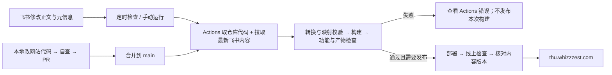
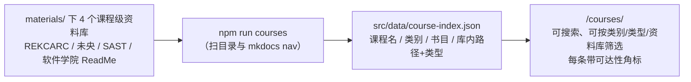

# 清华生存指南

> **2026-10-28 起，正文与文章信息在飞书维护，网站功能与发布流程仍由 GitHub 仓库维护。** 飞书替代日常内容编辑入口；JavaScript / TypeScript、Astro 组件、样式、数据生成与部署配置仍需修改代码。内容操作见 [飞书编辑与同步说明](./FEISHU-CONTENT.md)。

面向清华在校学生的经验分享站 —— 不是官方材料，是一群学长学姐把踩过的坑、绕过的路写下来。

**线上地址** <https://thu.whizzzest.com>　｜　**仓库** <https://github.com/pan-nie/TsinghuaSurvive>　｜　**最后更新** 2026-10-28

> ✅ **域名迁移记录（2026-10-12）** —— 站点迁至 `thu.whizzzest.com`（持有 `whizzzest.com` 的 Cloudflare 账号）：
> 当时已打通页面、`/api/*` 问答、`/media/*` 媒体出口、旧后台登录、CI 自动部署与线上冒烟。2026-10-28 的飞书内容迁移沿用这些云端资源，当前内容维护入口见下文。
>
> 两处**刻意不做**（维护者决定，不是遗漏）：① 旧域名不做 301，旧链接在域名到期后直接 404；
> ② 未开启 Always Use HTTPS（`http://` 仍可访问，canonical 已是 https，影响有限）。
> 详见 [HANDOVER.md](./HANDOVER.md) 第 8 节「已知限制」与 [MIGRATION.md](./MIGRATION.md)。
>
> 域名事实来源是 `site.config.json`，改域名跑 `npm run domain:sync`；线上巡检跑 `npm run check:live`。

> **本文回答**：我想做 X，该改哪里、跑哪条命令。
> **不回答**：部署与排障 → [HANDOVER.md](./HANDOVER.md)｜内容还缺什么 → [OUTLINE.md](./OUTLINE.md)｜为什么这么设计 → [REFERENCE-NOTES.md](./REFERENCE-NOTES.md)｜后台方案的决策记录 → [CONTENT-EDITING-PLAN.md](./CONTENT-EDITING-PLAN.md)
>
> 下面所有命令都在仓库根目录（`Tsinghua-guide/`）里跑。

---

## 一、30 秒上手

| 我想做什么 | 走哪条路 | 发布方式 |
| --- | --- | --- |
| **改正文 / 标题 / 作者 / 标签 / 摘要** | 从 [飞书总导航](https://my.feishu.cn/docx/S2FVdp173oWkY4x0v2dcKCcIn0f) 找到文章；站内 `/admin/` 和「编辑此页」也指向飞书 | 自动同步、检查后发布，详见 [FEISHU-CONTENT.md](./FEISHU-CONTENT.md) |
| **改互动工具 / JavaScript / 页面样式 / AI / 同步逻辑** | 本地 `npm ci && npm run dev` → 修改仓库代码 → 自查 → PR | 合并到 `main` 后自动同步飞书内容、构建部署 |
| **新增文章 / 调整栏目 / 改网址** | 维护者创建飞书文档并更新仓库映射与导航 | 不能只在飞书新建文档，见下一节 |
| **只想给素材 / 报问题** | 提 [Issue](https://github.com/pan-nie/TsinghuaSurvive/issues/new/choose) | 维护者核对后更新内容或代码 |

**两条路径在构建时汇合：飞书提供最新正文，GitHub 提供网站代码。** 定时同步计划在每小时第 7、22、37、52 分钟运行，GitHub 调度可能延迟；也可手动运行 [部署工作流](https://github.com/pan-nie/TsinghuaSurvive/actions/workflows/deploy.yml)。

> ⚠️ **不要直接修改已迁移文章的生成副本**：`src/content/docs/` 中的已迁文章、`src/data/feishu-custom.json`、`src/data/feishu-state.json`、`public/content-version.json` 会在同步时重新生成。修改这些副本不会反向写入飞书，下次同步会覆盖它们。CI 在构建副本中同步，不把每次飞书编辑自动提交回 GitHub，因此仓库中的文章不一定是线上最新正文。
>
> 旧 Sveltia CMS 编辑流程已停用，历史背景见 Git 历史与 [CONTENT-EDITING-PLAN.md](./CONTENT-EDITING-PLAN.md)。

---

## 二、我要改 X → 改哪里

### 1. 写内容

| 我想…… | 改哪里 | 怎么做 |
| --- | --- | --- |
| **改已有文章 / 首页说明 / 问答页说明** | 对应飞书文档 | 标题改文档标题；正文改「正文」与「迁移信息」之间的部分，保留 `【网站组件：…】` 标记 |
| **改作者 / 阶段 / 标签 / 摘要 / 页首提示** | 飞书「文档信息」表格 | 修改相应字段；支持范围见 [FEISHU-CONTENT.md](./FEISHU-CONTENT.md) |
| **标待核对 / 过期 / 人工复核日期** | 同一表格 | 内容状态填「待核对 / 已定稿 / 已过期」；最近人工核对只填实际日期，未核实不填 |
| **调文章导航名称 / 同栏目顺序** | 同一表格的「导航名称 / 导航顺序」 | 数字小的在前；同目录内不要重复。固定写在 `astro.config.mjs` 里的导航名称仍需改代码 |
| **写一篇新经验帖 / 新增独立页** | 新飞书文档 + `src/data/feishu-manifest.json` | 维护者按现有格式建文档，登记文档 ID、固定路径、栏目及元信息；需要时更新 `astro.config.mjs`。文件名用英文小写加连字符，完成后同步并跑 `npm run check:admin` |
| **加一个新分类 / 调整栏目 / 改网址** | `astro.config.mjs` + 飞书映射 | 同时核对侧边栏、目录、映射和已有链接；不会从飞书文件夹自动发现新栏目或文章 |
| **插图 / 附件 / 画板 / 嵌入电子表格** | 暂未接入飞书发布 | 目前遇到这些资源会停止同步；先由维护者适配同步与展示。不要沿用旧后台「拖图自动发布」的步骤 |
| **改站点标题 / 描述 / 联系方式** | `astro.config.mjs` 等站点配置 | 与文章标题、摘要不同，仍由仓库维护 |
| **改分享卡片图** | `scripts/generate-og.mjs` 顶部文案 | 改完跑 `npm run og`，生成图一起提交 |
| **改「多久算过期」** | `content-policy.json` | 改 `staleAfterMonths`；站点看门狗与 CI 检查读同一份 |

### 2. 网站功能与数据（仍需改代码）

| 我想…… | 改哪里 | 怎么做 |
| --- | --- | --- |
| **改学分计算 / 选课工作台 / 课程筛选** | `src/components/CreditPlanner.astro` / `SelectionWorkbench.astro` / `CourseExplorer.astro` | 这些文件包含浏览器端 JavaScript / TypeScript；飞书只保留工具说明与组件标记，不能修改计算、筛选、导入导出等逻辑。学分表和选课工作台的个人数据存于浏览器 localStorage |
| **改待办勾选保存 / 校内链接搜索** | `src/components/FeishuChecklist.astro` / `FeishuLinkSearch.astro` | 飞书维护清单文字与链接；网站代码负责个人进度保存和搜索交互 |
| **加新互动组件 / 改组件插入方式** | `src/components/FeishuSlots.astro` + `scripts/feishu/content.mjs` + 页面映射 | 先实现组件，注册名称并适配同步校验，再在飞书放对应标记；飞书代码块只展示代码，不会执行其中的 JavaScript |
| **改首页卡片 / 链接目录的排版** | `src/utils/feishu-directory.mjs`、相关组件与样式 | 内容在飞书，转换规则与展示效果在仓库；组件用 JS 生成元素时注意全局样式与独立前缀（见 HANDOVER §4） |
| **加校内网址 / 下载资料外链 / 第三方工具介绍** | 对应飞书目录文档 | 当前页面正文以飞书为准；`src/data/links.ts` / `resources.ts` / `tools.ts` / `archives.ts` 仍保留旧结构化数据，不能只改这些文件就认为展示页已更新。文件本体不要进仓库；核对日期与可用状态按实填写 |
| **更新课程资料索引 / 筛选数据** | `scripts/build-course-index.mjs` → `src/data/course-index.json` | 本地资料库变化后跑 `npm run courses` 并提交；课程筛选组件读取这些数据 |
| **更新课程书目页 / 技能页的映射表** | 对应飞书文档 + 必要的数据核对 | 迁移后正文已在飞书，不会仅因重建 `course-index.json` 自动重写这些正文表格；数据变化时需核对两处 |

### 3. AI 功能与内容同步（仍需改代码或配置）

| 我想…… | 改哪里 | 怎么做 |
| --- | --- | --- |
| **换 AI 模型 / 改限额** | `src/data/ai.config.yml` | 默认用 Workers AI；旧 Sveltia CMS 配置入口已停用 |
| **临时试第三方模型** | `/admin/ai/` | 选预设、填 Key、保存——运行时覆盖**立即生效，不用重新部署**。口令是 Worker Secret `ADMIN_TOKEN` |
| **改问答框交互 / 后端检索与提示词** | `src/components/AskBox.astro`、`src/worker/`、`src/utils/ai-tokenize.mjs` | 飞书只改问答页说明；功能修改后跑 `npm run check:ai` 和 `npm run check:ai:worker` |
| **改「清小搭」介绍** | 对应飞书文档 | 仍是介绍与外链；侧边栏固定分组名与条目在 `astro.config.mjs` |
| **改飞书转换 / 组件标记 / 文档映射** | `scripts/sync-feishu.mjs`、`scripts/feishu/`、`src/data/feishu-manifest.json` | 改完跑 `npm run check:feishu`、`npm run check:admin`，并同步预览 |
| **改同步频率 / 构建与发布流程** | `.github/workflows/deploy.yml` | 定时运行仅在内容变化时发布；推送 `main` 和手动触发会同步内容并构建发布 |

### 4. 检查与运维

| 我想…… | 跑什么 | 说明 |
| --- | --- | --- |
| **提 PR 前自查** | `npm run check:feishu` → `npm run verify` | 前者检查飞书转换；后者检查类型、内容、映射、媒体、构建与产物 |
| **看还欠着什么** | `npm run check:content` | 输出「债务总账」；当前快照见 [OUTLINE.md](./OUTLINE.md) |
| **测网址还活着吗** | `npm run check:links` | 写 `src/data/link-status.json`。**校园网里跑要标测点**：`LINK_CHECK_NETWORK='清华校园网（无线，DNS 166.111.8.28）'` |
| **核对入口还是干那件事吗** | `npm run verify:links` → 人工 `npm run review:links` | 脚本抓页面比对标题；人工核对清单是离线 HTML，导出后 `review:links:apply` 写回日期 |
| **回滚线上发布** | `npx wrangler versions list` → `npx wrangler rollback <ID>` | 版本 ID 从列表里取 |

---

## 三、命令速查

| 分组 | 命令 | 什么时候用 |
| --- | --- | --- |
| **日常开发** | `npm run dev` ｜ `npm run dev:worker` ｜ `npm run build` ｜ `npm run preview` ｜ `npm run check` | 本地开发功能与预览；`check` 是 `astro check`。**`dev` 是纯 Astro，看不到媒体**（`/media/*` 由 Worker 从 R2 读）；要看媒体用 `dev:worker` |
| **飞书同步与转换检查** | `npm run sync:feishu` ｜ `npm run check:feishu` | 同步需要本机配置官方 lark-cli；离线复核完整缓存用 `node scripts/sync-feishu.mjs --cached`。同步会刷新生成副本，见 FEISHU-CONTENT |
| **提 PR 前自查** | `npm run check:feishu` → `npm run verify` | `check:feishu` 单独运行；`verify` 包含类型、内容、映射、构建与产物检查，不会主动拉取飞书 |
| **内容检查** | `npm run check:content` ｜ `check:content:strict` | `strict` 连债务警告也当错误（发布前用） |
| **AI 问答** | `npm run check:ai` ｜ `check:ai:worker` | 索引体积 / 覆盖度 / 锚点 + 19 个真实提问的排序自测；后者直接跑 Worker 入口（闸门、鉴权、流式、fail-closed，43 项） |
| **内容映射与媒体** | `npm run check:admin` ｜ `check:media` ｜ `check:media:dist` ｜ `check:markup` | 飞书固定路径与编辑入口、媒体语法及产物、加粗标记是否泄漏 |
| **课程索引** | `npm run courses` ｜ `courses:check` | 前者扫本地资料库（`materials/`，取不到回落 `reference/`）重新生成，后者只校验（CI 用） |
| **链接** | `check:links` ｜ `verify:links [-- --apply]` ｜ `review:links [-- --open]` ｜ `review:links:apply -- <文件> [--write]` | 实测 → 语义核对 → 人工核对 |
| **本地自检** | `npm run check:e2e -- --base http://localhost:4321` ｜ `npm run measure:perf -- --base http://127.0.0.1:4322` | 无头 Chrome；**`--base` 写 `localhost`**，`astro preview` 在 macOS 上只绑 IPv6 回环 |
| **保留的旧后台与云资源命令** | `admin:vendor` ｜ `auth:dry` ｜ `auth:deploy` ｜ `r2:setup [-- --check]` | 用于历史运维，不是当前内容编辑入口；旧流程见 HANDOVER 与 Git 历史 |
| **域名与媒体出口** | `npm run domain:sync` ｜ `check:domain` ｜ `check:media:worker` ｜ `check:live` | 域名唯一来源是根目录 `site.config.json`：`domain:sync` 写入、`check:domain` 校验一致并扫旧标识残留、`check:media:worker` 端到端验证 `/media/*` 出口、`check:live` 部署后验线上真实站点（见 HANDOVER §5） |
| **部署** | `npm run deploy` ｜ `deploy:dry` | 平时不用跑：推 `main` 会自动部署 |

> 💡 **受限环境里的两个重定向**（`EPERM ... ~/.npm`、`EPERM ... .wrangler/logs`）：
> `export npm_config_cache="$PWD/.npm-cache" WRANGLER_LOG_PATH="$PWD/.wrangler-logs"`；
> `wrangler login` 还会往用户目录写令牌，可用 `XDG_CONFIG_HOME="$PWD/.wrangler-config"` 一起重定向（已被 `.gitignore` 忽略）。

---

## 四、目录结构

```
Tsinghua-guide/
├─ astro.config.mjs        站点配置：标题、侧边栏、SEO、视频语法糖处理器
├─ wrangler.jsonc          正式站（静态资源 + /api/* 问答接口 + /media/* 读 R2）｜域名与账号标识的事实来源是 site.config.json
├─ content-policy.json     ★ 时效阈值（看门狗与检查脚本共用，避免两边漂移）
├─ src/
│  ├─ content.config.ts    ★ 内容模型（frontmatter 校验规则）
│  ├─ content/docs/        ★ 已迁文章的生成副本；正文与元信息在飞书编辑
│  ├─ pages/               自定义路由：stages、tags、courses（索引 + 书目）、changelog、contributors、rss.xml
│  ├─ components/          ★ Banner（时效看门狗）、Head（JSON-LD）、LinkGrid、ToolDirectory、CourseExplorer、Checklist、CreditPlanner、SelectionWorkbench…
│  ├─ data/                ★ feishu-manifest.json（手改映射）；feishu-custom/state.json（同步产物）；课程索引与保留的旧目录数据
│  ├─ worker/              ★ 唯一的后端：/api/ask（检索+生成+流式）、/api/ai-config、/api/admin/*
│  ├─ utils/               feishu-directory.mjs（首页与目录展示适配）、media-embed.mjs、card-text.ts、ai-tokenize.mjs
│  └─ styles/custom.css    清华紫主题 + 中文排版
├─ scripts/                sync-feishu.mjs 与 feishu/（同步与转换）；其余检查与生成脚本见上一节
├─ public/admin/           ★ 当前内容维护导航（指向飞书）；config.yml 是保留的旧 CMS 配置
│  └─ ai/                  ★ 第三方 API Key 的填写页（密钥不进 git，加密后存 Durable Object）
├─ materials/              ⚠️ 本地资料库：6 个公开资料库整理后的分类版本（约 13 GB，已删各库 .git），**已在 .gitignore 里，不进仓库**
├─ reference/              ⚠️ 整理前的旧位置（现已清空；脚本仍认它作兜底）
├─ auth-worker/            旧 CMS 的 OAuth 中转（独立 Worker，不随主站 CI 部署）
└─ 文档：FEISHU-CONTENT / HANDOVER / OUTLINE / REFERENCE-NOTES / CONTENT-EDITING-PLAN（见文末地图）
                             AI 问答与首页改版的细节都在 HANDOVER 第 10、11 节
```

日常写作与目录文字在飞书；代码开发主要看 `src/components/`、`src/worker/`、`src/utils/`、配置与脚本。生成副本可用于本地预览，不作为内容主稿。

---

## 五、一次改动是怎么上线的



定时运行无内容变化时跳过发布；代码推送与手动运行仍会构建发布。同步生成的是本次构建使用的副本，不自动提交回仓库。当前只有部署工作流，**代码 PR 在合并前由开发者本地检查与预览**；合并后的构建检查才由该工作流运行。

| 发布与本地自查步骤 | 检查什么 |
| --- | --- |
| `sync:feishu` / `check:feishu` | 文档不可访问、表格或待办转换不完整、未知组件标记、未支持资源；转换回归检查单独运行 |
| `check` | 类型错误 |
| `check:domain` | 全仓旧域名残留、同步文件与 `site.config.json` 不一致（域名唯一来源，换域名时漏改一处就静默失效） |
| `check:content` | 站内死链、中文文件名、`reviewedAt` 写在未来、同目录 `sidebar.order` 冲突、`links.ts` 重名或非法网址、资料有提取码却没链接、课程索引引用了未定义的资料库 |
| `check:admin` | 当前检查飞书文档的固定路径、栏目、来源元信息与维护入口；不再走旧 CMS 字段检查 |
| `check:media` | 视频语法糖写错、外链图床、空 alt |
| `courses:check` | `course-index.json` 与 `materials/`（或旧的 `reference/`）里的资料库不一致（两处都没有时自动跳过） |
| `build` | frontmatter 字段错误（报错会指出文件名） |
| `check:ai` | AI 索引体积超标（冷启动会吃掉免费档的 CPU 预算）、有页面漏进索引、引用锚点在页面里不存在、19 个真实提问的排序退步或该拒答的没拒 |
| `check:ai:worker` | 闸门顺序（先限流后校验、都不消耗额度）、问题过长过短、无关提问不去问模型、流式分帧、后台鉴权、密钥不以明文落盘、Turnstile 六种 fail-closed 分支 |
| `check:jsonld` | JSON-LD 语法、同页重复 `@type`、面包屑 position 不连续、署名是占位符 |
| `check:assets` | 分享卡片尺寸不是 1200×630、文件为空、页面引用的图不存在 |
| `check:markup` | `**加粗**` 紧贴全角标点（`**「图库」**`）导致标记不生效、星号被原样印在页面上；banner 里写 Markdown 加粗；卡片文案漏调 `descHtml()` |
| `check:feeds`（本地 `verify`） / `check:media:dist` | sitemap 指向不存在的页面、RSS 缺字段、robots 把整站屏蔽；产物里的视频容器与源码对不上。当前部署工作流未单独运行 `check:feeds` |
| `check:media:worker` | `/media/*` 出口的 33 项断言：路径穿越、Range（含越界 416）、304、桶未绑定返回 503 而不是 404 |
| `check:live` | **线上真实站点**的 18 项冒烟：canonical / robots / sitemap / RSS 的域名、`/api/ai-config` 的 sitekey 与仓库配置是否一致、无 token 时 fail-closed、媒体 404、后台 noindex、404 页面与尾斜杠重定向、auth 白名单、http 是否跳 https。部署后自动跑（`deploy.yml`），也可手动 `npm run check:live -- --base <url>` |

> 看最新正文的渲染效果，先同步飞书，再用本地 `npm run dev`；要看已有 R2 媒体用 `npm run dev:worker`。飞书新增图片等资源的发布支持仍受前述限制。

---

## 六、课程资料索引是怎么来的

142 门课、185 条资料、52 门带书目 —— **不是人肉抄的，是扫出来的**（数据见 `src/data/course-index.json`）。



四个刻意的设计：

- **`materials/` 不进仓库**：6 个库整理后合计约 13 GB（大量 PDF，2026-10-05 实测；已删掉共约 11.3 GB 的 `.git`，24 GB → 13 GB），只在本地扫描用；扫描结果才提交，CI 与别人的机器都不需要它们。分类、来源与许可见 `materials/README.md`（该目录不进仓库，只在本地存在）。
- **本站不镜像任何文件**：索引里存「资料库 + 库内路径」，链接指向原库 —— 规避体积与版权，又给出「哪里有材料」的确定答案。
- **课程名会归一化**：上游目录里带老师姓名/昵称的（`面向对象程序设计基础-刘知远老师`）合并回课程名，规则在 `scripts/build-course-index.mjs` 的 `NAME_OVERRIDES`。
- **可达性优先**：校内 GitLab 镜像排在 GitHub 前面（原因见下一节）。

资料库换了目录结构就跑一次 `npm run courses`，然后提交 `course-index.json`。课程筛选组件继续读取此索引；已迁入飞书的书目页与正文表格需要另行核对更新。

---

## 七、链接为什么会变「打不开」

保留的结构化链接数据与检查脚本将可信度分为三层，**别混成一个「可信 / 不可信」**。当前链接目录正文在飞书，脚本写回旧数据文件不会自动更新飞书中的文字、日期或状态：

| 层 | 谁产生 | 能证明什么 |
| --- | --- | --- |
| **实测** | `npm run check:links` → `link-status.json` | 网址能打开（HTTP < 400）。**只证明域名活着** |
| **脚本核对** | `npm run verify:links -- --apply`（`verifiedBy: 'auto'`） | 抓页面比对标题与关键词，确认地址还指向那个服务（看不到登录后的内容） |
| **人工核对** | 人（`reviewedBy: 'human'` + `reviewedAt`） | 有人真的点开用过 —— **只有这一层能确认入口没写错、功能还在** |

> ⚠️ **先看清测点：在校园网里测「校外能不能开」是测不出来的。** 本机就在清华校园网内（无线 `183.173.x`、DNS `166.111.8.28`）：
> `getaddrinfo ENOTFOUND`（NXDOMAIN）说明**域名真的没了**，不要解释成「校外打不开」——上一轮就因此把上游两个死链误记成「等校内确认」；
> 校内 200 ≠ 校外能开。跑之前用 `LINK_CHECK_NETWORK='清华校园网（…）'` 标注测点，标注会写进 `link-status.json`。

当前状态（2026-10-06）：**64 条 / 63 条实测可访问**，63 条脚本核对 + 1 条人工核对（四六级报名，SPA + 反爬，脚本永远拿不到佐证）。本轮新增 4 条：学生学习与发展指导中心、《清华大学飞跃手册》、THU 手册（第三方）、数学课程学习指南；四条都已通过 `check:links` 与 `verify:links`。

---

## 八、内容红线

投稿与审稿都必须遵守，完整说明见站内《免责声明与内容边界》：

| ❌ 不写 | 为什么 |
| --- | --- |
| 内部系统的数据、截图、账号，或绕过权限的方法 | 会让人踩纪律，也伤害提供系统的人 |
| 对具体老师的指名评价 | 样本偏差大、时效性差、容易变成人身评价 |
| 他人隐私（学号、成绩、联系方式、名单） | 不可撤回 |
| 违反校规的做法 | 同第一条 |
| 付费内容导流 | 与「帮忙」的定位冲突 |

**不确定就标「待核对」，不要编一个看起来合理的数字** —— 这是本站最重要的一条规矩。

---

## 九、文档地图与排版约定

| 文档 | 回答什么 | 不回答什么 |
| --- | --- | --- |
| [README.md](./README.md)（本文） | 我想做 X 改哪里、跑哪条命令 | 运维细节、内容缺口、设计史 |
| [FEISHU-CONTENT.md](./FEISHU-CONTENT.md) | 当前飞书编辑、同步、支持范围与恢复 | 网站功能开发 |
| [HANDOVER.md](./HANDOVER.md) | 接手运维：资源 ID、部署、故障排查、性能基线；旧后台部分为历史记录 | 当前飞书日常写作 |
| [OUTLINE.md](./OUTLINE.md) | 内容路线图、每篇缺什么、债务总账 | 怎么做、为什么 |
| [REFERENCE-NOTES.md](./REFERENCE-NOTES.md) | 参考项目借鉴了什么、没借鉴什么、为什么 | 操作步骤 |
| [CONTENT-EDITING-PLAN.md](./CONTENT-EDITING-PLAN.md) | 旧 Sveltia CMS 方案的历史决策记录 | 当前飞书编辑操作（见 FEISHU-CONTENT） |

给后来写文档的人（本仓库根目录的 `.md` 统一遵守）：

1. 开头六行内交代：一句话定位 + **本文回答 / 不回答（去哪）** + 最后更新日期。
2. 固定状态符号：✅ 已完成 ｜ 🟡 有框架、事实待核实 ｜ ⬜ 未做 ｜ 🕒 会过期 ｜ ⚠️ 坑 ｜ 💡 技巧。
3. **能用表格就不用列表，能用列表就不用段落**；表格首列加粗，列数保持一致。
4. 呼出块用 `> ✅ **…**` / `> ⚠️ **…**`，**不要用 `:::tip`** —— 这些文件不在站点里，GitHub 不渲染容器语法。
5. 长历史 / 证据放进 `<details><summary>` 折叠块；重复内容只留一处，其余写「见 X 文档 §Y」。
6. **数字必须带实测日期**；不确定就写「待核对」，不写「大约」。
7. 中英文之间不加空格；命令、路径、字段名一律用反引号。

---

## 许可

内容采用 **CC BY-NC-SA 4.0**。学校官方文件版权归学校所有，本站只做链接引用。
